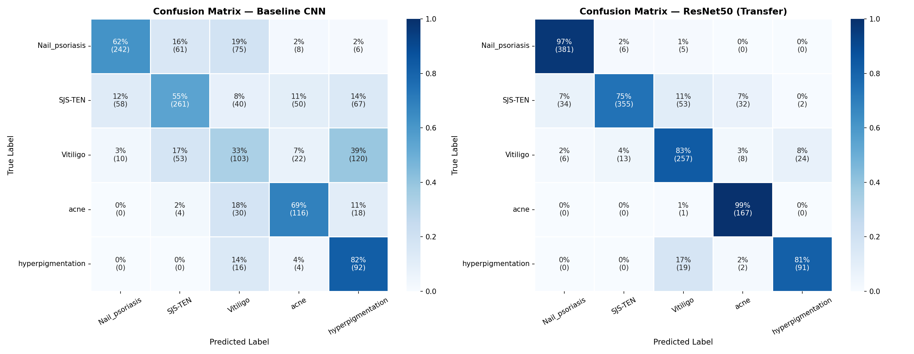

# Skin Disease Classification

An image-classification project comparing a convolutional neural network trained from scratch with ResNet50 transfer learning. The models classify clinical skin photographs into five skin-condition categories. This repository contains the final end-to-end notebook, saved visualizations, and project documentation.

**Course project:** ADTA 5550, Deep Learning with Big Data
**Team:** Akanksha Tiwari

---

## Problem Statement

This project evaluates whether convolutional models can distinguish five skin-condition classes from images. It is an academic experiment, not a clinical screening or diagnostic tool.

---

## Dataset

**Source:** [Skin Disease Classification Dataset — Mendeley Data](https://data.mendeley.com/datasets/3hckgznc67/1)  
**DOI:** 10.17632/3hckgznc67.1  
**Published:** July 2024 · Collected from hospitals across multiple countries

| Class | Image files | Unique source photos |
|-------|------------:|---------------------:|
| Acne | 1,148 | 41 |
| Vitiligo | 2,016 | 72 |
| Hyperpigmentation | 700 | 25 |
| Nail Psoriasis | 2,520 | 90 |
| SJS-TEN | 3,164 | 113 |
| **Total** | **9,548** | **341** |

The published dataset is **pre-augmented**: each source photo appears as 28 files (crops, padding, resizing, hue and saturation shifts, flips, and superpixel renderings). Files derived from the same photo are near-duplicates, so the notebook **splits by source photo** into train / validation / test (70 / 15 / 15% of photos per class). No photo appears in more than one split. Class imbalance is handled with a class-weighted loss.

Dataset images are not included in this repository; see [`data/README.md`](data/README.md) for download and folder setup instructions.

## Models

- **Baseline CNN:** Three convolutional blocks trained from scratch, followed by a dense classification head. Pixels are scaled to [0, 1].
- **ResNet50:** ImageNet-pretrained backbone with a custom classification head, using ResNet50's own input preprocessing (`preprocess_input`). Trained in two phases: (1) head only with the backbone frozen, (2) fine-tuning of the last residual block (`conv5`) at a low learning rate with BatchNorm frozen. The checkpoint with the lowest validation loss is kept.

Both models use 224 × 224 RGB inputs, the same on-the-fly augmentation, and predict the same five classes.

---

## Results

Evaluated on the held-out **test set**: 52 source photos (1,456 files) never used for training or model selection.

| Model | Test accuracy | Test macro-F1 | Test loss | Accuracy on 52 original photos |
|-------|-------------:|--------------:|----------:|------------------------------:|
| Baseline CNN | 55.91% | 0.547 | 1.285 | 59.6% |
| ResNet50 transfer learning | **85.92%** | **0.851** | **0.449** | **94.2%** |

- **Transfer learning wins clearly:** +30.0 percentage points in accuracy and +0.30 macro-F1, and higher F1 on every class.
- **The baseline CNN overfits:** training accuracy reached 79% while validation accuracy stayed near 55–60%.
- **ResNet50's best checkpoint used a frozen backbone:** fine-tuning `conv5` raised training accuracy to 98.6% without improving validation loss.
- **Hardest classes:** SJS-TEN has the lowest ResNet50 recall (75%). Vitiligo and hyperpigmentation, both pigmentation disorders, are often confused with each other.



**Caveats:** the test set contains only 52 independent photos (4 for hyperpigmentation), and a single split and seed were used, so small differences should not be over-interpreted. These results do not establish performance on external data or clinical use. See Section 7 of the notebook for full discussion and limitations.

### Revision note

An earlier version of this project reported 92.30% validation accuracy for the baseline CNN and 57.13% for ResNet50. Those numbers were invalid for two reasons:

1. **Leakage:** a file-level `validation_split` placed variants of every validation photo in the training set (100% of validation files were affected).
2. **Wrong ResNet50 input scaling:** ResNet50 received [0, 1] pixels instead of `preprocess_input`.

Correcting both reversed the comparison.

---

## Repository Structure

```
Skin-Disease-Classification/
├── data/                  # Dataset (not tracked by git — see data/README.md)
├── notebooks/
│   └── Skin_Disease_Classification.ipynb  # Final end-to-end analysis and modeling
├── models/                # Generated model weights (not tracked)
├── results/               # Figures and model_comparison.csv
└── README.md
```

---

## Run the Notebook

**1. Clone the repo:**
```bash
git clone https://github.com/unt-akanksha/Skin-Disease-Classification.git
cd Skin-Disease-Classification
```

**2. Install the notebook dependencies** (Python, TensorFlow/Keras, NumPy, Pandas, Matplotlib, Seaborn, Pillow, and scikit-learn):
```bash
pip install tensorflow numpy pandas matplotlib seaborn pillow scikit-learn
```

**3. Download the dataset:**
See [`data/README.md`](data/README.md) for instructions.

**4. Open and run** [`notebooks/Skin_Disease_Classification.ipynb`](notebooks/Skin_Disease_Classification.ipynb) from top to bottom. A GPU is not required: the full run takes about 2 hours on an Apple M4 CPU (TensorFlow 2.21). On Google Colab, select a T4 GPU runtime and follow the instructions in the notebook's first cell.

---

## Tech Stack

Python, TensorFlow/Keras, NumPy, Pandas, Matplotlib, Seaborn, scikit-learn, and Jupyter Notebook.

---

## License

MIT License — see [LICENSE](LICENSE) for details.

> **Disclaimer:** This project is for academic purposes only and is not intended for clinical use.
